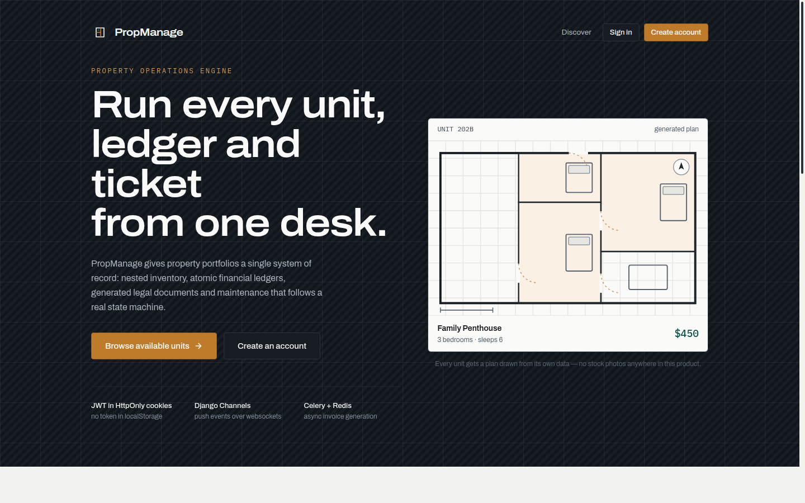
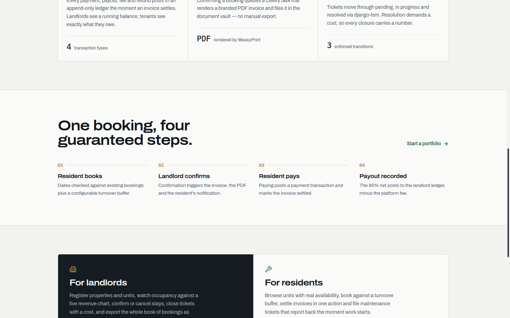
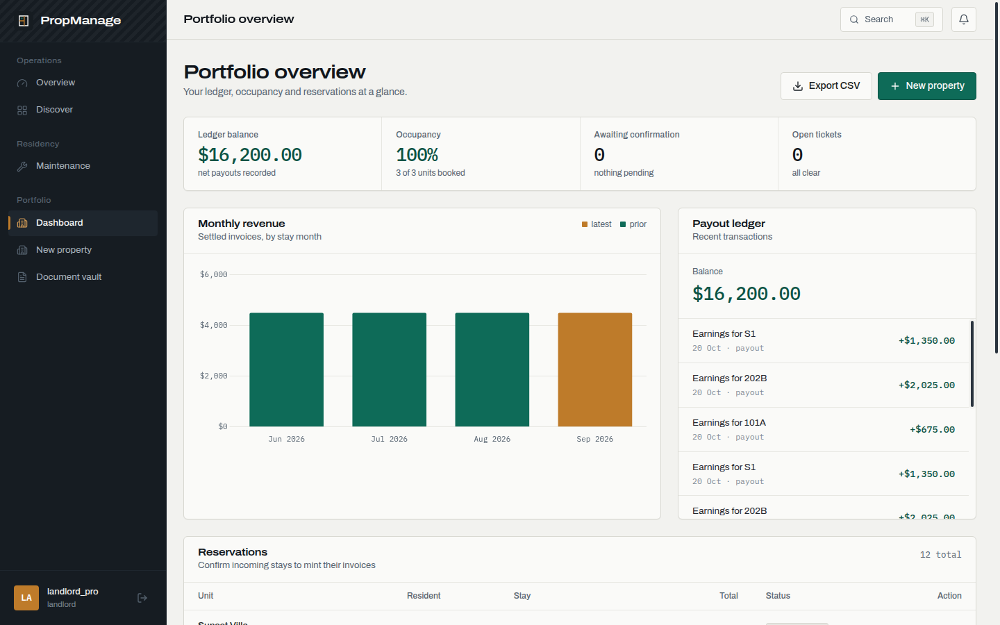
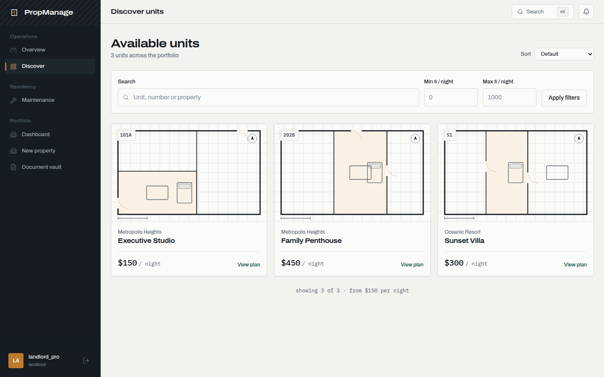
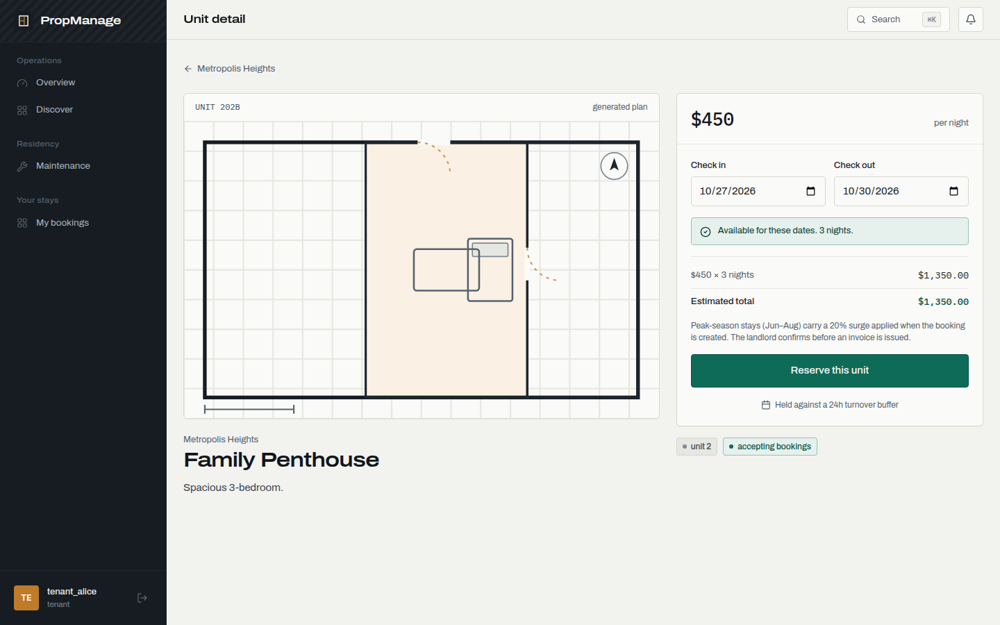
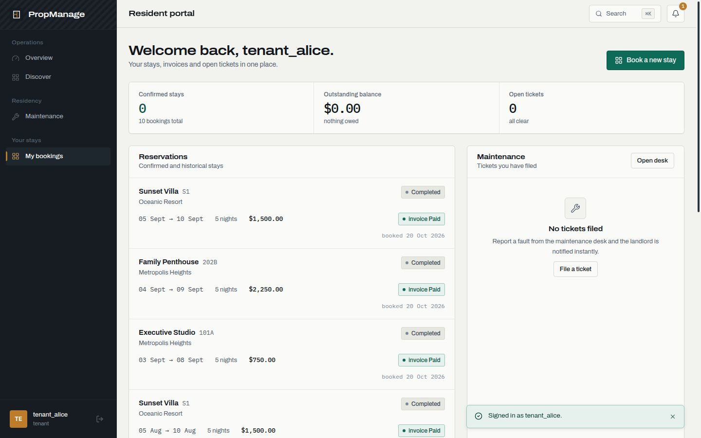
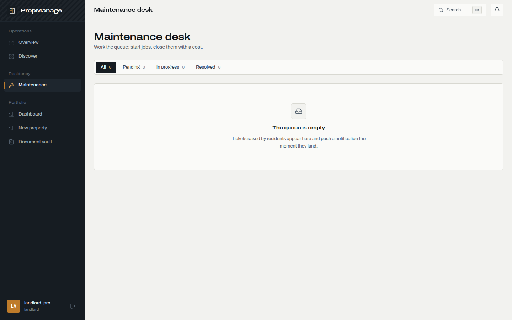
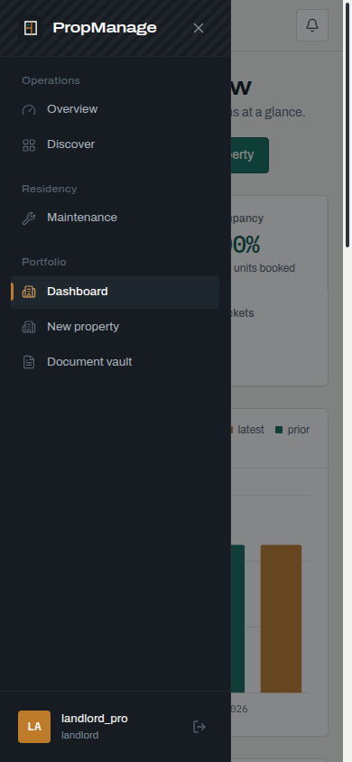

# PropManage — Property Operations Engine

A full-stack property management platform: nested inventory, a financial
ledger, PDF document generation, and a maintenance workflow driven by a finite
state machine, with push updates over WebSockets.

A few implementation details worth knowing before you read further: booking
writes run inside a database transaction with a row lock on the unit, the
maintenance state machine will not resolve a ticket until a cost is recorded,
the JWT lives only in an HttpOnly cookie, and the frontend draws each unit's
floor plan procedurally instead of using stock photography.

---

## Demo

```bash
docker compose up --build -d
docker compose exec backend python manage.py seed_data
```

Open **http://localhost:5173** and use the one-click demo fills on the login
screen:

| Role | Username | Password |
|---|---|---|
| Landlord (portfolio, ledger, tickets) | `landlord_pro` | `pass123` |
| Resident (bookings, invoices, tickets) | `tenant_alice` | `pass123` |

Seeded: 2 properties, 3 units, 12 bookings spanning four months, 12 invoices
and 24 ledger transactions.

---

## Highlights

### Transactional booking and ledger writes
Bookings, invoices, payments, refunds, fees and payouts share one subsystem
rather than four loosely-coupled models. `create_booking()` runs under
`@transaction.atomic()` with `select_for_update()` on the unit row, so two
concurrent requests cannot both pass the same availability check. Ledger rows
have no edit or delete endpoint — the only code that removes them is the demo
seed command resetting data. Confirmed bookings queue a Celery task that
renders a PDF invoice (WeasyPrint) into the document vault.

### Maintenance workflow as a state machine
Tickets move `pending → in_progress → resolved` via `django-fsm`. django-fsm
raises on any transition outside its declared sources, and `resolve` carries a
condition requiring `cost > 0`, so a ticket cannot close without a recorded
cost.

### Authentication and access control
The JWT is stored in an **HttpOnly cookie**, so client-side script cannot read
it; `localStorage` holds only the user profile object for the first render,
never credentials. Token refresh is a server call that issues a new cookie.
Access control is per-object rather than per-route only: `IsOwnerOrReadOnly`
keeps landlords on their own properties, and the booking, invoice and
maintenance querysets are filtered by role — an object outside that scope
isn't in the queryset, so the request returns 404.

### Realtime
Django Channels over a WebSocket at `/ws/notifications/`, authenticated from
the same JWT cookie. Booking confirmations, ticket state changes and invoice
events push to the connected client as soon as they happen. The client
reconnects with backoff and keeps a rolling activity history behind the
header bell.

### Two role-scoped views behind one login

- **Landlord** — portfolio dashboard (occupancy, monthly revenue chart,
  payout ledger), booking confirmation that mints invoices, ticket queue with
  FSM transitions, document vault, CSV export of all bookings.
- **Resident** — discover units, live availability check against existing
  bookings + a configurable turnover buffer, one-click invoice payment, ticket
  filing.

---

## Interface

> Complete rewrite. The previous UI was discarded rather than restyled.

**Design language — "Console & Plan Set".** A dark graphite console rail sits
against a light concrete workspace. Structure comes from hairline borders and
aligned rules, not soft drop shadows; radii stay at 4–6px. One accent
(brass `#BE7B2A`) marks what needs attention, pine `#0E6B58` marks what's
settled. Typography pairs **Archivo** — using its `wdth` axis so headlines set
*expanded* (~112–118%) while body text stays normal — with **IBM Plex Mono**
restricted to tabular financial data.

**The signature visual:** `FloorPlan.jsx` generates a deterministic procedural
floor plan for every unit, seeded from that unit's own data. Rooms are carved
with alternating splits so they always tile the shell exactly; bedrooms get
bed glyphs, the largest room a table, interior walls get doorway gaps with
brass swing arcs, plus a north arrow and scale bar. Unit 3 always draws the
same plan, and no two units share one. This replaces all photography — there
are no images to license and nothing to break offline.

The rest of the UI follows the same conventions:

- **Stat strips** are one panel divided by hairlines, never three identical cards.
- **Status colours are semantic**: pine = settled, brass = needs you, signal = blocked, ink = inert.
- **Motion is one orchestrated entrance** per page plus functional micro-transitions — no scattered fade-ups. Honours `prefers-reduced-motion`.

### Structure

```text
frontend/src/
├── index.css                 # design tokens (crete/ink/pine/brass scales)
├── layouts/ConsoleLayout.jsx # rail, header, ⌘K, notification bell, mobile drawer
├── components/
│   ├── FloorPlan.jsx         # procedural plan generator (the signature)
│   ├── CommandPalette.jsx    # ⌘K server-side search
│   └── ui/                   # Button, Panel, Field, StatusTag, StatStrip, Modal…
├── lib/format.js             # money, dates, DRF error flattening
├── lib/status.js             # status → tone maps (split for fast-refresh)
└── pages/                    # 11 screens
```

Removed from the previous UI: `App.css`, `BaseButton`, `BaseCard`,
`PropertyCard`, `NotificationToast`, `Omnisearch`, `DefaultLayout`,
`tailwind.config.js`, and all Unsplash image URLs.

---

## Tech stack

| Layer | Choice |
|---|---|
| API | Django 4.2, Django REST Framework, drf-spectacular (OpenAPI) |
| Async | Daphne (ASGI), Django Channels, Celery + Redis |
| Auth | `djangorestframework-simplejwt` — HttpOnly cookie transport |
| DB | PostgreSQL |
| Frontend | React 19, Vite 7, React Router 7, Zustand 5 |
| Styling | Tailwind CSS v4 (CSS-first `@theme` tokens) |
| Charts | Chart.js + react-chartjs-2 |
| Motion | Framer Motion |
| Deploy | Docker Compose locally, Render via `render.yaml` |

Services: `db`, `redis`, `backend`, `celery_worker`, `frontend` (Nginx),
`mailpit` (email inbox for dev).

---

## Project layout

```text
├── backend/
│   ├── billing/        # invoices, payments, transactions, ledger
│   ├── bookings/       # availability, pricing, FSM-adjacent booking flow
│   ├── maintenance/    # ticket FSM (django-fsm)
│   ├── notifications/  # Channels consumers + routing
│   ├── properties/     # Property > Unit inventory, documents, search
│   ├── users/          # auth, roles, RBAC
│   └── config/         # settings, celery, api router
├── frontend/           # React SPA
├── docker-compose.yml
├── render.yaml         # Render deployment
├── DEPLOY.md           # deployment walkthrough + free-tier caveats
└── MASTER_PLAN.md      # original roadmap and technical specs
```

---

## API

Mounted at `/api/v1/`. Interactive OpenAPI (Swagger) UI at **`/api/docs/`**, raw
schema at `/api/schema/`, ReDoc at `/api/redoc/` — all live once the backend
is running. Roughly:

```
POST   /auth/token/                     # sets HttpOnly access + refresh cookies
POST   /auth/token/refresh/
POST   /auth/logout/
GET    /users/me/

GET    /properties/  POST /properties/
GET    /properties/my_properties/
GET    /units/?search=&min_price=&max_price=&ordering=
GET    /units/{id}/check_availability/?start_date=&end_date=

GET    /bookings/  POST /bookings/
POST   /bookings/{id}/confirm/  POST /bookings/{id}/cancel/
GET    /bookings/monthly_revenue/
GET    /bookings/download_bookings_csv/

GET    /billing/invoices/  POST /billing/invoices/{id}/pay/
GET    /billing/invoices/landlord_ledger/

GET    /maintenance/requests/  POST /maintenance/requests/
POST   /maintenance/requests/{id}/start_work/  POST .../resolve/   # requires cost
GET    /documents/  GET /documents/{id}/download/

GET    /search/?q=                      # global search across the portfolio
WS     /ws/notifications/               # JWT cookie authenticated
```

---

## Getting started

**1. Launch the stack**

```bash
docker compose up --build -d
```

**2. Seed demo data**

```bash
docker compose exec backend python manage.py seed_data
```

**3. Optional admin account**

```bash
docker compose exec backend python manage.py createsuperuser
```

**4. Open the app** — http://localhost:5173 (UI), http://localhost:8000/api/schema/docs/ (API docs)

### Frontend development

```bash
cd frontend
npm install
npm run dev      # http://localhost:5173 with HMR
npm run lint     # ESLint — clean
npm run build    # production build
```

The axios instance reads `VITE_API_URL` (defaulting to
`http://localhost:8000/api/v1`). In Docker the Nginx container proxies `/api/`
and `/ws/` to the backend.

---

## Deployment

Infrastructure is defined in [`render.yaml`](./render.yaml); step-by-step
instructions, architecture notes, and free-tier caveats are in
**[DEPLOY.md](./DEPLOY.md)**.

---

## Screenshots

Captured from the running stack.

**Landing** — hero with the generated plan sheet


**Capabilities & booking flow**


**Landlord console** — stat strip, revenue chart (latest month in brass), payout ledger


**Discover** — three units, three distinct generated plans


**Unit detail** — live availability check + booking rail


**Resident portal** — reservations, invoice status, tickets


**Maintenance desk** — segmented queue with FSM transitions


**Mobile** — console drawer

